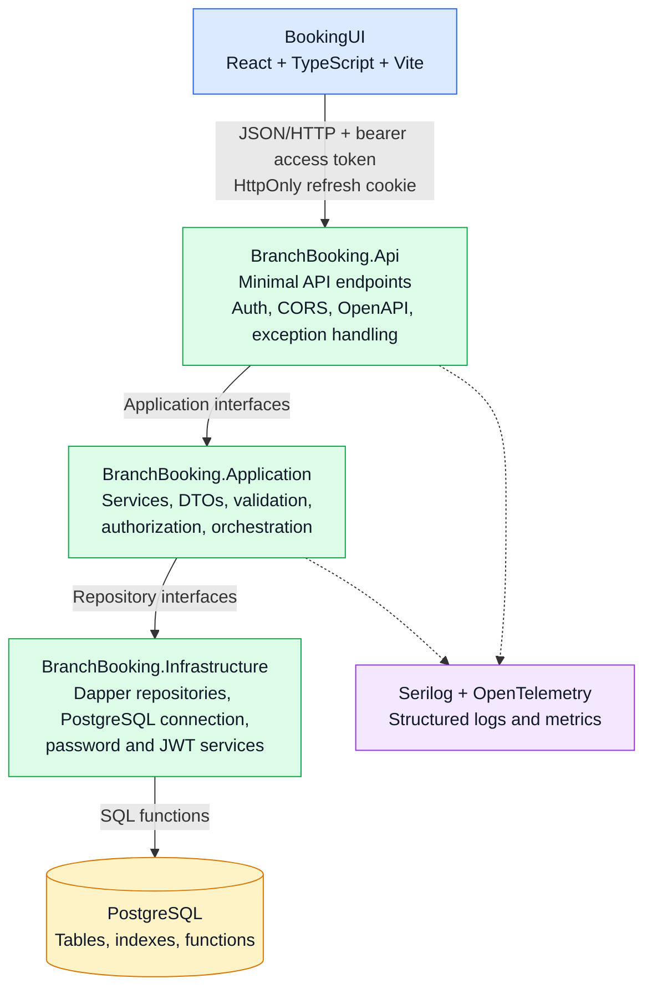
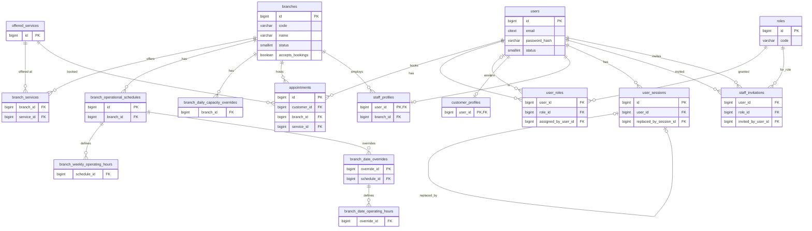

# BranchBookingSolution

BranchBookingSolution is a branch-based appointment booking platform. It provides a role-aware React web application, a .NET 10 Minimal API, and a PostgreSQL persistence layer for managing branches, branch configuration, staff access, customer bookings, and appointment operations.

The repository contains two applications:

- `BranchBookingApi` - the .NET 10 backend solution.
- `BookingUI` - the React/Vite frontend.

The database schema and PostgreSQL functions are maintained in `DatabaseScripts`.

## Contents

- [Product overview](#product-overview)
- [Technology stack](#technology-stack)
- [Architecture](#architecture)
- [User roles and authorization](#user-roles-and-authorization)
- [Features](#features)
- [Repository structure](#repository-structure)
- [Backend API](#backend-api)
- [Frontend application](#frontend-application)
- [Database and persistence](#database-and-persistence)
- [Local development setup](#local-development-setup)
- [Configuration](#configuration)
- [Running the applications](#running-the-applications)
- [Testing](#testing)
- [UI and layout decisions](#ui-and-layout-decisions)
- [Security decisions](#security-decisions)
- [Error handling and observability](#error-handling-and-observability)
- [Deployment considerations](#deployment-considerations)
- [Known limitations and operational notes](#known-limitations-and-operational-notes)
- [Development conventions](#development-conventions)

## Product overview

BranchBookingSolution supports the complete appointment lifecycle:

1. Administrators create and configure branches.
2. Branch services, operating hours, date overrides, and capacity overrides are configured.
3. Staff and branch managers operate within their assigned branch scope.
4. Customers register, authenticate, select a bookable branch and service, choose an available time slot, and confirm an appointment.
5. Customers can review, cancel, and reschedule appointments.
6. Operational users can review upcoming appointments and appointment history according to their role and branch assignment.

The application uses a responsive single-page frontend backed by a JSON HTTP API. The backend performs domain validation and authorization, while PostgreSQL functions provide the primary data access boundary.

## Technology stack

### Backend

- .NET 10
- ASP.NET Core Minimal APIs
- C# with nullable reference types and implicit usings enabled
- `Microsoft.AspNetCore.Authentication.JwtBearer` for access-token authentication
- ASP.NET Core policy-based authorization
- Dapper for PostgreSQL access
- Npgsql through the application infrastructure layer
- PostgreSQL functions and SQL scripts for persistence operations
- Serilog for structured application/request logging
- Swagger/OpenAPI in the Development environment
- NUnit and NSubstitute for automated tests
- `Microsoft.AspNetCore.Mvc.Testing` and `WebApplicationFactory` for HTTP integration tests

### Frontend

- React
- TypeScript
- Vite
- React Router
- Lucide React icons
- CSS-based responsive layout in `src/styles/globals.css`
- Vitest and Testing Library for frontend tests
- Fetch-based API client with bearer-token and refresh-cookie support

### Data and infrastructure

- PostgreSQL
- PostgreSQL `citext` extension for case-insensitive email handling
- SQL functions for paging, authentication, branch operations, configuration, and appointments
- Browser `HttpOnly` refresh cookie for refresh-token storage

## Architecture

The solution is organized into a layered backend and a feature-oriented frontend.



### Backend project responsibilities

| Project | Responsibility |
| --- | --- |
| `BranchBooking.Core` | Domain models, records, enums, and domain exceptions. It has no dependency on infrastructure or the web layer. |
| `BranchBooking.Application` | Service interfaces and implementations, DTOs, request models, business rules, and repository abstractions. |
| `BranchBooking.Infrastructure` | PostgreSQL connection factory, Dapper repositories, password hashing, and JWT token services. |
| `BranchBooking.Api` | Application composition, authentication, authorization policies, middleware, and Minimal API endpoint groups. |
| `BranchBooking.Tests` | NUnit service tests and HTTP integration tests using an in-process test host. |

### Architectural decisions

- **Minimal APIs** keep endpoint composition explicit and reduce controller ceremony for this application size.
- **Application interfaces** separate business orchestration from persistence and make services testable with substitutes.
- **PostgreSQL functions** centralize SQL operations, paging, lifecycle rules, and multi-table queries close to the data.
- **Dapper** provides direct, predictable SQL mapping without introducing a full ORM model-tracking layer.
- **Feature-oriented frontend folders** keep components, hooks, services, and types close to the feature that owns them.
- **Explicit role policies** protect endpoint groups, while branch-access checks enforce assignment scope for staff and managers.
- **Local React state and feature hooks** are used instead of a global state library because the current workflows are page-oriented and the API client owns authentication transport concerns.

## User roles and authorization

The application currently supports these roles:

| Role | Scope and capabilities |
| --- | --- |
| `Admin` | Full system access. Manages branches, branch configuration, staff, customers, and all operational appointments. |
| `BranchManager` | Manages and views configuration and operations for an assigned branch. |
| `Staff` | Views and operates on appointments for an assigned branch, subject to staff restrictions. |
| `Customer` | Registers, authenticates, selects bookable services, creates appointments, and manages their own appointments. |

Authorization is implemented in two layers:

1. Endpoint policies such as `AdminOnly`, `StaffOrAdmin`, and `CustomerOnly` verify the required role.
2. Branch-aware services verify that a staff member or branch manager is allowed to access the requested branch.

The frontend also protects routes for a better user experience, but backend authorization remains authoritative.

## Features

### Authentication and account management

- Customer registration.
- Login with access-token response and refresh-token cookie.
- Access-token refresh with refresh-token rotation.
- Logout and session revocation.
- Current-user retrieval.
- Failed-login tracking and account lockout behavior.
- Staff invitation creation and invitation acceptance.
- Staff directory paging and staff status updates.
- Role-based access using database-backed roles.

### Branch management

- Create branch records.
- View branches in a paged table.
- Default branch table page size of 5.
- Search branches by code, name, address, city, province, or postal code.
- Select alternate page sizes of 10, 20, or 50.
- View branch status and whether bookings are currently accepted.
- Edit branch details.
- Activate and deactivate branches.
- Branch activation validation requires valid operating hours and at least one active service.

### Branch configuration

- Branch details and identity information.
- Offered-service assignment and activation.
- Operating schedules with effective date ranges.
- Weekly opening hours.
- Date-specific overrides.
- Capacity overrides.
- Branch activation/deactivation workflow.
- Branch-scoped configuration access for branch managers.

### Customer appointments

- Bookable branch lookup.
- Bookable services for a selected branch.
- Availability lookup for a date range.
- Weekly availability display.
- Appointment creation.
- Appointment confirmation dialog before saving.
- Upcoming appointment list.
- Appointment history.
- Appointment cancellation.
- Appointment rescheduling while preserving the original service and branch context.

### Operational appointments

- Upcoming appointment review for staff and branch managers.
- Appointment history for permitted operational users.
- Admin-wide operational appointment visibility.
- Branch-scoped operational visibility for assigned staff and managers.
- Staff restrictions on historical appointment access are enforced by the API.

### Frontend experience

- Responsive application shell with navigation sidebar and top bar.
- Role-aware landing redirects.
- Protected routes and forbidden-access page.
- Loading, empty, error, and retry states.
- Toast notifications for successful and failed actions.
- Confirmation dialogs for destructive or consequential actions.
- Responsive tables and mobile-friendly controls.
- Consistent page headings, section cards, buttons, form controls, and status badges.

## Repository structure

```text
BranchBookingSolution/
├── README.md
├── BookingUI/
│   ├── src/
│   │   ├── app/                 # Router and route guards
│   │   ├── components/          # Shared UI and layout components
│   │   ├── features/
│   │   │   ├── appointments/    # Customer and operational appointments
│   │   │   ├── auth/            # Login, registration, invitations, auth context
│   │   │   ├── branches/         # Branch CRUD and configuration
│   │   │   ├── customers/        # Customer directory
│   │   │   ├── overview/         # Admin overview
│   │   │   └── staff/            # Staff directory and invitations
│   │   ├── lib/                 # API and query helpers
│   │   ├── styles/              # Global responsive styles
│   │   └── test/                # Frontend test setup
│   ├── package.json
│   ├── vite.config.ts
│   └── tsconfig*.json
├── BranchBookingApi/
│   ├── BranchBooking.Api/              # Web host and Minimal API endpoints
│   ├── BranchBooking.Application/      # Services, DTOs, requests, interfaces
│   ├── BranchBooking.Core/             # Domain models and exceptions
│   ├── BranchBooking.Infrastructure/   # PostgreSQL/Dapper and security services
│   ├── BranchBooking.Tests/            # NUnit unit and integration tests
│   └── BranchBookingApi.slnx
└── DatabaseScripts/
	└── V1_*.sql through V12_*.sql      # PostgreSQL schema and functions
```

## Backend API

The API is hosted by `BranchBooking.Api` and registers endpoint groups in `Program.cs`.

### Authentication endpoints

| Method | Route | Authorization | Purpose |
| --- | --- | --- | --- |
| `POST` | `/api/auth/register` | Public | Register a customer. |
| `POST` | `/api/auth/login` | Public | Authenticate and issue an access token plus refresh cookie. |
| `POST` | `/api/auth/refresh` | Refresh cookie | Rotate the refresh session and issue a new access token. |
| `POST` | `/api/auth/logout` | Public/session-aware | Revoke the refresh session when present and clear the cookie. |
| `GET` | `/api/auth/me` | Authenticated | Return the current user. |
| `POST` | `/api/auth/staff/invitations` | Admin | Invite a staff member or branch manager. |
| `GET` | `/api/auth/staff` | Admin | Return the paged staff directory. |
| `PATCH` | `/api/auth/staff/{userId}/status` | Admin | Update staff account status. |
| `POST` | `/api/auth/staff/invitations/accept` | Public | Accept a staff invitation. |

### Branch endpoints

| Method | Route | Authorization | Purpose |
| --- | --- | --- | --- |
| `GET` | `/api/branches` | Admin | Paged branch list. Supports `pageNumber`, `pageSize`, and `searchTerm`. Default page size is 5. |
| `GET` | `/api/branches/{branchId}` | Staff or Admin | Read a branch after branch-access validation. |
| `POST` | `/api/branches` | Admin | Create a branch. |
| `PUT` | `/api/branches/{branchId}` | Admin | Update branch details. |
| `POST` | `/api/branches/{branchId}/activate` | Admin | Activate a branch after configuration validation. |
| `POST` | `/api/branches/{branchId}/deactivate` | Admin | Deactivate a branch and stop bookings. |

Example branch list request:

```http
GET /api/branches?pageNumber=1&pageSize=5&searchTerm=Johannesburg
Authorization: Bearer <access-token>
```

### Branch configuration endpoints

| Method | Route | Authorization | Purpose |
| --- | --- | --- | --- |
| `GET` | `/api/branches/{branchId}/services` | Staff or Admin | Read services configured for a branch. |
| `POST` | `/api/branches/{branchId}/services` | Staff or Admin | Add or update a branch-service assignment. |
| `GET` | `/api/offered-services` | Staff or Admin | List available services. |
| `GET` | `/api/branches/{branchId}/date-overrides` | Staff or Admin | Read date overrides, optionally filtered by date range. |
| `POST` | `/api/branches/{branchId}/date-overrides` | Staff or Admin | Create a date override. |
| `PUT` | `/api/branches/{branchId}/date-overrides/{overrideId}` | Staff or Admin | Update a date override. |
| `DELETE` | `/api/branches/{branchId}/date-overrides/{overrideId}` | Staff or Admin | Delete a date override. |
| `GET` | `/api/branches/{branchId}/capacity-overrides` | Staff or Admin | Read capacity overrides. |
| `POST` | `/api/branches/{branchId}/capacity-overrides` | Staff or Admin | Create or update capacity configuration. |
| `DELETE` | `/api/branches/{branchId}/capacity-overrides/{capacityOverrideId}` | Staff or Admin | Delete a capacity override. |
| `GET` | `/api/branches/{branchId}/operational-schedules` | Staff or Admin | Read the effective operational schedule. |
| `POST` | `/api/branches/{branchId}/operational-schedules` | Staff or Admin | Create an operational schedule. |

Branch managers and staff are additionally checked against their assigned branch where applicable.

### Customer appointment endpoints

All routes in this group require the `Customer` role.

| Method | Route | Purpose |
| --- | --- | --- |
| `GET` | `/api/customer/branches` | List branches currently available for customer booking. |
| `GET` | `/api/customer/branches/{branchId}/services` | List bookable services for a branch. |
| `GET` | `/api/customer/branches/{branchId}/availability` | Return available slots for a service and date range. |
| `GET` | `/api/customer/appointments` | Return the customer’s upcoming or historical appointments. |
| `POST` | `/api/customer/appointments` | Create an appointment. |
| `POST` | `/api/customer/appointments/{appointmentId}/cancel` | Cancel a customer appointment. |
| `POST` | `/api/customer/appointments/{appointmentId}/reschedule` | Reschedule a customer appointment. |

### Operational appointment endpoints

| Method | Route | Authorization | Purpose |
| --- | --- | --- | --- |
| `GET` | `/api/appointments` | Staff or Admin | Return operational appointments with history and paging options. |

Admins can see all branches. Staff and branch managers are restricted to their assigned branch, and staff cannot request historical appointments.

### Other endpoints

| Method | Route | Authorization | Purpose |
| --- | --- | --- | --- |
| `GET` | `/api/customers` | Admin | Return the paged customer directory. |

## Frontend application

The frontend is a Vite application with a feature-oriented structure.

### Routes

| Route | UI | Access |
| --- | --- | --- |
| `/login` | Login | Public |
| `/register` | Customer registration | Public |
| `/accept-invitation` | Staff invitation acceptance | Public |
| `/overview` | Admin overview | Admin |
| `/branches` | Branch list and management | Admin |
| `/branches/:branchId/configuration` | Branch details and configuration workspace | Admin or Branch Manager |
| `/appointments` | Customer or operational appointment page based on role | Customer, Staff, Branch Manager, or Admin |
| `/appointments/book` | Customer booking screen | Customer |
| `/appointments/:appointmentId/reschedule` | Customer rescheduling screen | Customer |
| `/customers` | Customer directory | Admin |
| `/staff` | Staff directory and invitation management | Admin |
| `/forbidden` | Access-restricted page | Authenticated users |

`App.tsx` composes `AuthProvider`, `BrowserRouter`, `ProtectedRoute`, and `AppLayout`. The appointment page is shared by customer and operational roles and selects its view from the authenticated user role.

### Frontend data flow

1. `AuthProvider` restores the current session by calling `/api/auth/me`.
2. `authService` calls authentication endpoints and stores the access token in memory.
3. `apiClient` adds the bearer token and includes credentials for the refresh cookie.
4. A 401 response triggers one refresh attempt through `/api/auth/refresh`.
5. Feature services call typed API endpoints.
6. Feature hooks manage loading, error, paging, refresh, and mutation state for their screens.

Access tokens are intentionally kept in memory rather than local storage. The refresh token is managed by the backend as an `HttpOnly` cookie.

## Database and persistence

PostgreSQL is the source of truth for users, roles, branches, configuration, and appointments. The infrastructure layer uses Dapper to call PostgreSQL functions. The API does not embed complex SQL queries in endpoint or application service code.

### Script order

Apply the scripts in version order to a new database:

| Script | Purpose |
| --- | --- |
| `V1_Create_Branch_Tables.sql` | Creates the core `branches` table. |
| `V2_Branch_Functions.sql` | Branch listing, paging/search, and creation functions. |
| `V3_Branch_Scheduling_Tables.sql` | Scheduling and operating-hours tables. |
| `V4_Branch_Operations_Functions.sql` | Operational schedule functions. |
| `V5_Branch_Configuration_Functions.sql` | Offered services, date overrides, and capacity configuration functions. |
| `V6_Branch_Activation_Functions.sql` | Branch activation validation and related functions. |
| `V7_Branch_Lifecycle_Functions.sql` | Branch update and lifecycle functions. |
| `V8_Authentication_Tables.sql` | Users, roles, user roles, profiles, sessions, and staff invitations. |
| `V9_Customer_Appointments.sql` | Appointment table and indexes. |
| `V10_Staff_Branch_Assignment.sql` | Adds assigned branch support to staff profiles. |
| `V11_Inline_SQL_Functions.sql` | Additional inline SQL functions used by the application. |
| `V12_Staff_Management.sql` | Staff lookup, invitation, directory, and status-management functions. |
| `V13_Test_Data.sql` | Local development/test branches, services, schedules, and weekly operating hours. |
| `V14_Offered_Service_Pagination.sql` | Database-backed pagination, search, and availability filtering for offered services. |
| `V15_Api_Correctness.sql` | Corrective function definitions for closed-day schedules and safe offered-service deletion. |
| `V16_Remove_Unused_Objects.sql` | Removes obsolete schedule functions and authentication tables from existing databases. |

The repository currently uses versioned SQL scripts rather than an application-managed migration runner. Apply new or changed scripts explicitly in each environment.

### Important database objects

- `branches`
- `offered_services`
- Branch-service assignments
- Operational schedules and weekly operating hours
- Date overrides
- Capacity overrides
- `users`
- `roles` and `user_roles`
- `customer_profiles`
- `staff_profiles`
- `user_sessions`
- Staff invitations
- `appointments`

The authentication schema installs the PostgreSQL `citext` extension for case-insensitive emails and seeds the core `Admin`, `Staff`, and `Customer` roles. `V12_Staff_Management.sql` adds the `BranchManager` role.

### Entity relationship diagram



### Branch paging and search

`get_all_branches` returns branch rows with a windowed `total_count`. The optional search term is applied before the count and supports case-insensitive matching against branch code, name, address, city, province, and postal code. Page sizes are clamped by the application and database function to a maximum of 200; the UI exposes 5, 10, 20, and 50.

## Local development setup

### First administrator account

The API includes a disabled-by-default, one-time bootstrap administrator seeder. It does not expose a bootstrap HTTP endpoint and it will not run unless both `BootstrapAdmin:Enabled` and `BootstrapAdmin:Confirm` are true. It also refuses to create an administrator when an active administrator already exists.

For local development, configure the credentials with user secrets rather than committing them to `appsettings.json`:

```powershell
dotnet user-secrets init --project BranchBookingApi/BranchBooking.Api
dotnet user-secrets set "BootstrapAdmin:Enabled" "true" --project BranchBookingApi/BranchBooking.Api
dotnet user-secrets set "BootstrapAdmin:Confirm" "true" --project BranchBookingApi/BranchBooking.Api
dotnet user-secrets set "BootstrapAdmin:Email" "admin@example.com" --project BranchBookingApi/BranchBooking.Api
dotnet user-secrets set "BootstrapAdmin:FirstName" "System" --project BranchBookingApi/BranchBooking.Api
dotnet user-secrets set "BootstrapAdmin:LastName" "Administrator" --project BranchBookingApi/BranchBooking.Api
dotnet user-secrets set "BootstrapAdmin:Password" "Use-a-unique-12-character-or-longer-password!" --project BranchBookingApi/BranchBooking.Api
```

Start the API once. After the administrator is created, set `BootstrapAdmin:Enabled` and `BootstrapAdmin:Confirm` back to `false` and remove the bootstrap password from the secret store. Never commit bootstrap credentials, passwords, or generated password hashes.

### Prerequisites

Install the following before starting development:

- .NET 10 SDK
- Node.js with npm
- PostgreSQL compatible with the supplied scripts
- Git
- Optional: Visual Studio with ASP.NET and web development workloads, or the .NET CLI and a JavaScript editor

### 1. Clone the repository

```powershell
git clone <repository-url>
cd BranchBookingSolution
```

### 2. Create and configure PostgreSQL

Create a database, for example:

```sql
CREATE DATABASE branch_booking;
```

Apply the scripts in `DatabaseScripts` in the order listed above. The default development connection string targets:

```text
Host=localhost;Port=5432;Database=branch_booking;Username=postgres;Password=<your-password>
```

Do not use the repository’s development password or signing key in a shared or production environment.

### 3. Restore backend dependencies

```powershell
dotnet restore .\BranchBookingApi\BranchBookingApi.slnx
```

### 4. Install frontend dependencies

```powershell
Set-Location .\BookingUI
npm install
```

## Configuration

### API configuration

The API reads standard ASP.NET Core configuration. The main settings are:

```json
{
  "ConnectionStrings": {
	"BookingDatabase": "Host=localhost;Port=5432;Database=branch_booking;Username=postgres;Password=<secret>"
  },
  "Cors": {
	"AllowedOrigins": [ "http://localhost:5173" ]
  },
  "Jwt": {
	"Issuer": "BranchBookingApi",
	"Audience": "BookingUI",
	"SigningKey": "<at-least-32-character-secret>",
	"AccessTokenMinutes": 10,
	"RefreshTokenDays": 30
  },
  "OpenTelemetry": {
    "Metrics": {
      "Exporter": "disabled",
      "OtlpEndpoint": ""
    }
  }
}
```

Use environment variables, user secrets, or deployment secret storage for credentials. Do not commit real database passwords or JWT signing keys.

Equivalent environment variable names include:

```text
ConnectionStrings__BookingDatabase
Cors__AllowedOrigins__0
Jwt__Issuer
Jwt__Audience
Jwt__SigningKey
Jwt__AccessTokenMinutes
Jwt__RefreshTokenDays
OpenTelemetry__Metrics__Exporter
OpenTelemetry__Metrics__OtlpEndpoint
```

The API requires a configured database connection string and a JWT signing key of at least 32 characters during startup.

### Frontend configuration

The frontend accepts an optional `VITE_API_BASE_URL` value:

```text
VITE_API_BASE_URL=https://localhost:44309
```

When `VITE_API_BASE_URL` is not set, API calls use relative `/api` paths. The Vite development server proxies `/api` to `https://localhost:44309` with certificate validation disabled for local development.

If the API uses a different local port, update `BookingUI/vite.config.ts` or set `VITE_API_BASE_URL` appropriately.

## Running the applications

### Start the API

From the repository root:

```powershell
dotnet run --project .\BranchBookingApi\BranchBooking.Api\BranchBooking.Api.csproj
```

The API exposes Swagger/OpenAPI in the Development environment. The exact HTTP/HTTPS URLs depend on `launchSettings.json` and the local ASP.NET Core launch configuration.

### Start the frontend

In a second terminal:

```powershell
Set-Location .\BookingUI
npm run dev
```

Vite serves the frontend on port 5173 by default.

### Build the frontend

```powershell
Set-Location .\BookingUI
npm run build
```

The build runs TypeScript project compilation followed by the Vite production build.

### Preview the frontend build

```powershell
Set-Location .\BookingUI
npm run preview
```

## Testing

### Backend tests

Run all .NET tests:

```powershell
dotnet test .\BranchBookingApi\BranchBookingApi.slnx
```

The backend suite includes:

- Authentication service tests.
- Branch service tests.
- Branch access tests.
- Branch configuration tests.
- Operational schedule tests.
- Appointment service tests.
- Customer service tests.
- Branch endpoint integration tests.

The integration tests use `WebApplicationFactory<Program>`, a test authentication handler, and a substituted application service. They exercise the real HTTP routing, authorization policies, query binding, and response serialization without requiring a live PostgreSQL database.

### Frontend tests

Run the configured Vitest suite:

```powershell
Set-Location .\BookingUI
npm run test
```

Frontend test setup is in `BookingUI/src/test/setup.ts`. The Vite configuration uses the `jsdom` environment and restores mocks between tests.

### Build validation

```powershell
dotnet build .\BranchBookingApi\BranchBookingApi.slnx
Set-Location .\BookingUI
npm run build
```

## UI and layout decisions

### Application shell

The authenticated experience uses a shared shell consisting of:

- A dark navigation sidebar for primary feature navigation.
- A top bar for workspace context and user information.
- A scrollable page-content region.
- Responsive mobile navigation behavior below the mobile breakpoint.

### Page hierarchy

Feature pages follow a consistent visual hierarchy:

1. Page heading with an eyebrow, title, description, and optional primary action.
2. Section cards for tables, configuration forms, or summary content.
3. Shared buttons, form controls, status badges, empty states, loading states, and error states.

This keeps the overview, branches, customers, staff, configuration, and appointment pages visually consistent without coupling their feature logic.

### Booking flow

The customer booking and rescheduling flow is route-based rather than a modal-only screen:

- `/appointments/book` and reschedule routes render a full booking screen.
- The screen provides a top-right “Back to appointments” action.
- Branch and Service selectors share a row on larger screens and stack on narrow screens.
- Available days and slots are displayed after a branch and service are selected.
- Selecting a time slot opens the existing confirmation dialog.
- The confirmation dialog remains modal because confirming a booking is a consequential action.

The legacy modal variant remains available for code paths that use it, including its close control and modal Cancel action.

### Responsive behavior

The global stylesheet uses responsive CSS media queries rather than a component library. Important behaviors include:

- Sidebar collapse and mobile header below 760px.
- Responsive page headings and section controls.
- Responsive data tables and horizontally scrollable slot grids where required.
- Branch and service form stacking on narrow booking screens.
- Touch-friendly slot and action buttons.

### State and feedback

Screens expose loading and failure states instead of silently rendering incomplete data. Mutations use confirmation dialogs where appropriate and toast notifications for success or failure. Pagination and search state are owned by the relevant feature hook so page transitions and refreshes are predictable.

## Security decisions

- JWT bearer access tokens are validated for issuer, audience, signing key, and lifetime.
- Refresh tokens are stored in a secure, `HttpOnly` cookie scoped to `/api/auth`.
- Refresh sessions are rotated and can be revoked as a token family.
- Passwords are handled by the infrastructure password service rather than stored in plaintext.
- Authorization uses named policies and role claims.
- Branch-scoped access is checked on the server for staff and branch managers.
- Customer appointment operations derive the customer identity from the authenticated principal instead of accepting arbitrary customer IDs from the client.
- CORS origins are explicitly configured.
- Development secrets are placeholders and must be replaced through secure configuration in real environments.

## Error handling and observability

- `GlobalExceptionHandler` maps application/domain failures into HTTP problem responses.
- Domain validation uses dedicated exception types.
- Serilog provides structured request logging and console output by default.
- Authentication lifecycle, startup, request, and domain-exception events use structured log fields without recording passwords, access tokens, refresh tokens, or email addresses.
- OpenTelemetry collects ASP.NET Core and .NET runtime metrics together with API request count, duration, and error metrics.
- Metrics export is disabled by default and can be enabled with the `console` or `otlp` exporter through `OpenTelemetry:Metrics:Exporter`.
- ASP.NET Core framework logs are reduced to Warning by default in the main configuration.
- Frontend API failures are converted into user-facing errors by `apiClient`, with server problem details used when available.
- Feature pages provide retry actions for recoverable loading failures.

## Deployment considerations

Before deploying:

1. Provision PostgreSQL and apply every database script in order.
2. Replace development database credentials and JWT settings with managed secrets.
3. Configure the production frontend origin in `Cors:AllowedOrigins`.
4. Set a production `VITE_API_BASE_URL` or serve the frontend and API behind a compatible same-origin/reverse-proxy arrangement.
5. Use HTTPS for the API and frontend so the secure refresh cookie works correctly.
6. Configure appropriate logging sinks and retention for the deployment environment.
7. Build the API and frontend in CI and publish the resulting artifacts.
8. Confirm the database function version used by the deployed API matches the repository version.
9. Run backend tests and frontend tests as part of CI.

The repository does not currently include a container definition, cloud deployment manifest, CI workflow, or automatic database migration runner. These should be added as deployment requirements evolve.

## Known limitations and operational notes

- Database scripts are versioned but are applied manually; maintain an external record of which scripts have run in each environment.
- The API’s default local connection string is for development only.
- The local Vite proxy targets `https://localhost:44309`; update it when the API launch profile uses a different port.
- The current frontend API client stores the access token in memory, so a full page reload relies on the refresh cookie and `/api/auth/refresh`.
- Search and pagination for the branches table are server-side. The database function update must be applied before the deployed API can use the new search parameter.
- Some endpoint workflows depend on configured branch services, schedules, capacity, and role assignments before a branch can be activated or booked.

## Development conventions

- Keep domain rules in `BranchBooking.Core` or `BranchBooking.Application`, not in endpoint lambdas.
- Add new persistence operations behind repository interfaces and PostgreSQL functions.
- Keep endpoint authorization explicit with named policies.
- Preserve branch-access checks when adding staff or branch-manager features.
- Keep frontend API calls in feature service modules and expose reusable loading/mutation behavior through hooks.
- Preserve accessible labels, button types, roles, and `aria-label` attributes on interactive controls.
- Reuse existing shared UI classes and responsive patterns before adding feature-specific styles.
- Add or update automated tests for service behavior, authorization-sensitive endpoint behavior, and important frontend interactions.
- Avoid committing secrets, local database passwords, generated build output, or environment-specific configuration.

## License and project status

No license file or production support policy is currently included in the repository. Treat the project as an actively developed application and confirm licensing, ownership, and operational support requirements before external distribution or production use.
